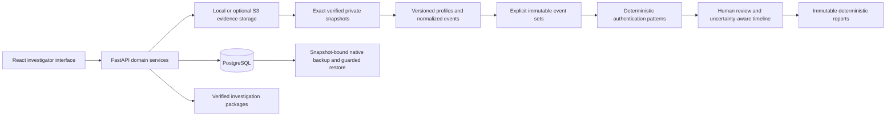

# Provena

Provena is an experimental authentication incident investigation workbench. Analysts
register and verify evidence, interpret supported logs, investigate deterministic
patterns, review findings and export traceable reports and investigation packages.

React/TypeScript, FastAPI and PostgreSQL form a modular monolith. Evidence and
verifiable analysis are the sources of truth. No model, paid API or external service
is required. Reports use deterministic templates, not free-form LLM conclusions.

## Status

The internal version is **0.1.0-beta.0**, an unpublished prerelease. M0-M5 provide
workspace isolation, exact-byte evidence snapshots, reproducible analysis, normalized
events, authentication detections and recovery/export tooling. M6 adds real Chromium
workflow testing, integration hardening, navigation improvements and documentation gates.

Suitable for controlled local evaluation with synthetic or explicitly authorized data.
Not certified forensic software and not an autonomous compromise detector. Public
release is blocked on owner-approved licensing, confirmed private security reporting,
release approval and operational validation. No license grant is implied by repository
visibility. The live AWS deployment is separate and may lag this source; these workflows
neither access nor deploy it.

## What you can investigate

- Linux SSH/PAM authentication: accepted/failed password/public-key, invalid users,
  supported session and explicit denial records in auth.log/secure-style text.
- Structured Windows Security JSON/JSONL/CSV exports: 4624, 4625, 4634, 4648 and 4740.
- Structured Sysmon 1/3 process/network context, never authentication verdicts.
- Repeated-failure, spraying, success-after-failure, explicit-lockout and mixed-outcome
  burst candidates over explicitly selected immutable event sets.
- Uncertain source times, exact source locators, entity pivots, analyst decisions and
  immutable report history.

Artifact analysis separately supports bounded TXT/LOG, CSV, JSON and machine-readable
PDF. Native binary EVTX, OCR, arbitrary XML, disk/memory image decoding, a SIEM/EDR,
automatic enforcement and trained anomaly detection are not implemented. See the
[investigator guide](docs/investigator-guide.md) for exact workflows and limits.

## Quickstart

Requirements: Docker Compose, or Python 3.13, Node.js 22 and PostgreSQL 16 for native
setup. Chromium is needed only for browser tests.

```sh
docker compose up --build --wait
```

Open [localhost:5173](http://localhost:5173). Register an account, create a workspace,
then choose **New investigation**. The development stack uses separate database,
evidence and export-cache volumes, loopback ports and demonstration credentials.
Never expose it as a production configuration or remove volumes containing real cases.
Registration needs no pre-seeded account.

Follow the [synthetic M4 demonstration](sample-data/m4-authentication/README.md): upload
the three supplied files, verify each, create the matching profiles in **Security Events**,
ingest them, then save explicit inputs in **Authentication** and run detections. Review
one proposal before generating a report. **Exports** defaults to metadata only;
original bytes require an explicit authorized selection and fresh integrity checks.

```sh
# From backend/, verify a downloaded package offline:
python -m app.ops.archive downloaded-export.zip
```

A passing unsigned manifest proves internal consistency, not authenticity or legal
admissibility. Packages can contain confidential accounts, excerpts and evidence.

## Architecture



See [architecture](docs/architecture.md), [security](docs/security.md) and
[evidence integrity](docs/evidence-integrity.md).

## Development and tests

The [development guide](docs/development.md) covers native setup, migrations and failure
artifacts. Existing PowerShell helpers remain a local-development convenience, not the
browser test harness or an approved production deployment path.

```sh
# Backend, in an activated clean virtual environment:
cd backend
python -m pip install -r requirements.txt
python -m pytest
python -m pip check
python -m pip install "pip-audit>=2.9,<3"
python -m pip_audit -r requirements.txt
# Frontend, separately:
cd ../frontend
npm ci
npm run lint
npm run typecheck
npm test
npm run build
npm audit
npm audit --omit=dev
```

Run browser tests from the repository root using the backend environment:

```sh
# Set M6_POSTGRES_TEST_URL to a dedicated localhost provena_ci control database.
# Install Chromium once from frontend/: npx playwright install chromium
python tools/run_e2e.py
python tools/check_docs.py
```

The browser runner creates a randomly named disposable database and private temporary
storage. It refuses remote/control-database ambiguity and never reuses a running app.
The main workflow uses real APIs and Chromium; mocks are restricted to the explicit
network-failure case. See [browser setup](docs/development.md) before running it.

## Guides and release readiness

- [Investigator workflow](docs/investigator-guide.md)
- [Operator setup, backup, restore and troubleshooting](docs/operations.md)
- [Developer and browser testing guide](docs/development.md)
- [M6 implementation and readiness assessment](docs/m6-implementation.md)
- [Release process and blockers](docs/releases.md)
- [Contributing](CONTRIBUTING.md), [security disclosure](SECURITY.md), [community rules](CODE_OF_CONDUCT.md)
- [Documentation index and historical milestones](docs/README.md)

CI enforces security, backend/frontend tests, PostgreSQL compatibility, browser workflows,
documentation checks, verified candidate packaging and disposable container startup.
Candidates remain validation-only, `publishable=false`. CI does not create a release,
choose a license or deploy to AWS.
