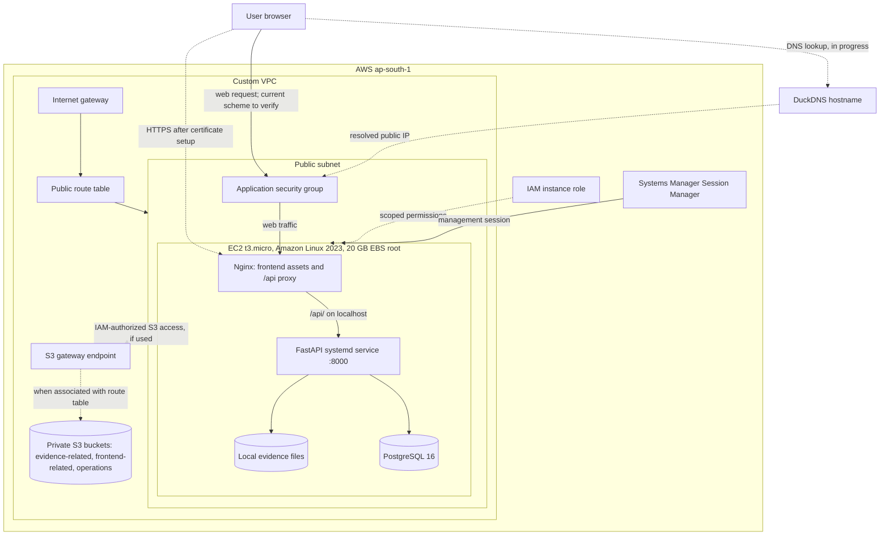
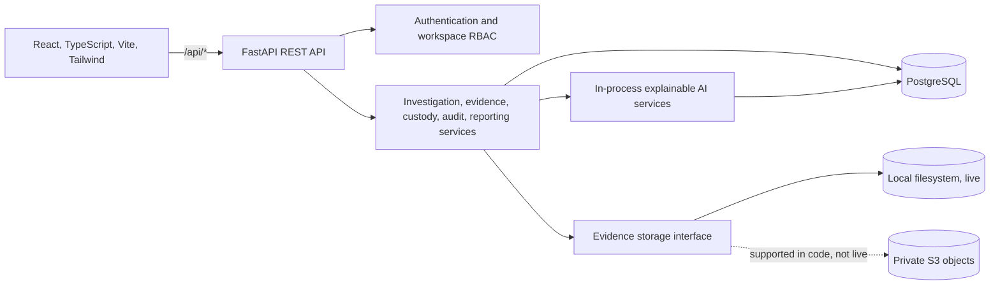
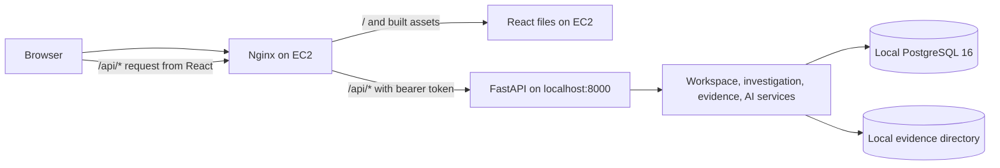
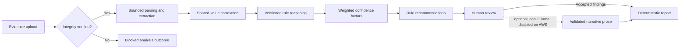

# Provena

**A full-stack, explainable AI-assisted digital investigation platform deployed on AWS.** Provena brings case management, evidence integrity, chain of custody, traceable analysis, human review, and immutable reporting into one workspace. The same project demonstrates three connected disciplines:

| Dimension | What Provena implements |
| --- | --- |
| Software engineering | React interface, FastAPI modular monolith, PostgreSQL persistence, workspace and case authorization, tested investigation workflows |
| Artificial intelligence | Deterministic extraction and correlation, versioned investigative rules, weighted confidence, recommendations, optional grounded report prose |
| Cloud architecture | A single-instance AWS deployment with EC2, VPC networking, EBS, IAM, Systems Manager, S3 resources, Nginx, and systemd |

The cloud host runs the same application and AI pipeline used locally. Findings are proposals for a human investigator, not conclusions of guilt. Provena is not certified forensic software and makes no legal admissibility claim.

## Current deployment status

The team reports an operational deployment in **Asia Pacific (Mumbai), `ap-south-1`**. The deployment inventory below is supplied by the project team; this repository does not contain live AWS infrastructure definitions or account access to verify individual resources.

| Component | Current deployment |
| --- | --- |
| Compute | One Amazon Linux 2023 `t3.micro` EC2 instance with a 20 GB EBS root volume |
| Network | Custom VPC, public subnet, internet gateway, route tables, security groups, and an S3 gateway VPC endpoint |
| Web | React/Vite production build served by Nginx; Nginx proxies `/api/` to FastAPI on localhost port 8000 |
| Application | FastAPI as a systemd service; PostgreSQL 16 on the same EC2 instance, not Amazon RDS |
| Evidence | Local EC2 filesystem selected by `EVIDENCE_STORAGE_BACKEND=local` and `EVIDENCE_STORAGE_ROOT` |
| AWS access | EC2 instance role with scoped permissions; Systems Manager Session Manager for administration |
| S3 | Separate evidence-related, frontend-related, and operations/backup buckets exist; the live application does not store evidence in S3 or serve the frontend from S3 |
| Narrative model | `LLM_ENABLED=false`; deterministic analysis and report prose continue without Ollama |

**HTTPS configuration is in progress.** The intended completed path uses a free DuckDNS hostname, Let's Encrypt certificate, Nginx TLS termination, HTTP-to-HTTPS redirection, automatic certificate renewal, and DNS updates when the public EC2 IP changes. Do not treat TLS or automatic DNS renewal as operational until verified. No CloudFront, load balancer, Auto Scaling, multi-AZ setup, ECS, EKS, Lambda, or Elastic Beanstalk is deployed.

Production URL: `https://<verified-duckdns-hostname>/` (placeholder, publish only after DNS and HTTPS acceptance).

## AWS architecture

Solid arrows show the reported current path. Dotted arrows show the intended DuckDNS/TLS path or conditional S3 routing. The S3 gateway endpoint carries S3 traffic only if it is associated with the instance subnet's route table. S3 buckets are not the live frontend or evidence store.



The current instance is a single point of failure. PostgreSQL and evidence files share its operational fate; backups, restore testing, disk monitoring, and access controls therefore matter. See [AWS deployment](docs/aws-deployment.md) for the current topology and procedure.

## Application architecture



The backend is a modular monolith. PostgreSQL stores users, workspace membership, investigations, evidence metadata and digests, custody and verification history, artifacts, correlations, findings, reports, and audit events. Raw evidence bytes live outside PostgreSQL. Alembic manages schema changes. Backend authorization enforces access. Details: [system architecture](docs/architecture.md) and [security](docs/security.md).

## Deployment request flow



Nginx serves frontend routes and forwards API routes with their `/api` prefix. FastAPI authenticates and authorizes requests before domain services access PostgreSQL or evidence. The final DuckDNS/HTTPS setup will terminate TLS at Nginx after validation. See the [deployment guide](docs/aws-deployment.md).

## Investigation workflow

1. Register or sign in, then create a workspace or join one through an invite. Workspace roles are administrator, investigator, forensic analyst, and evidence custodian.
2. Create a numbered investigation, assign its lead and team, set priority and status, and record notes.
3. Register evidence. Provena stores it under an opaque key, records an immutable upload SHA-256 baseline, and starts an append-only custody chain.
4. Recompute SHA-256 on verification. Results are `verified`, `mismatch`, or `unavailable`; evidence also begins as `not_verified`. Each attempt preserves expected and observed values.
5. Select evidence for analysis. Only `verified` evidence is processed; other states have explicit blocked outcomes. Supported text, log, CSV, JSON, and machine-readable PDF inputs yield provenance-bearing artifacts.
6. Inspect shared-value correlations and rule-generated findings. The Why view explains matched conditions, supporting artifacts and evidence, confidence factors, and recommendations.
7. An investigator accepts or rejects proposals. Reports snapshot accepted findings, case context, custody and evidence summaries, notes, generation metadata, and a SHA-256 content hash. Audit history records the workflow.

Search and dashboard views are scoped to the active workspace. Archived investigations are read-only for ordinary users. Reports are immutable snapshots rather than live re-renderings of current case state.

## Explainable AI pipeline



The pipeline uses regular expressions, key-aware structured rules, normalization, `pypdf` for machine-readable PDFs, correlation, and three versioned rules: `identity-recurrence`, `removable-media-session`, and `external-transfer-sequence`. Artifacts retain source evidence, locator, raw and normalized values, context, and extractor version. Correlations cite contributors. Confidence is a deterministic weighted ranking score from 0 to 100, **not a probability** or Bayesian inference.

Optional Ollama integration renders accepted structured findings into prose and validates its JSON shape, finding references, and concrete facts against the supplied context. Invalid or unavailable model output falls back to deterministic prose. The LLM does not determine integrity, extract artifacts, run rules, set confidence, or approve findings. **spaCy is not installed or used by the current pipeline.** It is a possible future NLP extension, subject to provenance and evaluation requirements. See [AI architecture](docs/ai-architecture.md) and [future enhancements](docs/future-enhancements.md).

## Technology stack

| Layer | Current technology |
| --- | --- |
| Frontend | React 19, TypeScript, Vite, Tailwind CSS v4, React Router, Vitest |
| Backend | Python, FastAPI, Pydantic v2, SQLAlchemy 2, Alembic, Uvicorn |
| Database | PostgreSQL 16 on EC2 in the reported deployment; Docker Compose locally |
| Analysis | Built-in Python parsing and rules, `pypdf`, deterministic scoring; optional Ollama over HTTP; no spaCy dependency |
| Cloud | EC2, EBS, VPC, security groups, internet gateway, S3 gateway endpoint, IAM role, S3 buckets, Systems Manager |
| Web operations | Nginx and systemd in the reported deployment; DuckDNS and Let's Encrypt TLS configuration in progress |
| Security | bcrypt password hashes, JWT bearer tokens, workspace and investigation RBAC, SHA-256 evidence baselines, append-only custody/audit records; HTTPS planned pending verification |

The frontend stores its bearer token in `localStorage`. This is exposed to injected page JavaScript, so the deployment needs strict input handling, dependency hygiene, and reviewed browser security headers. The application has not been certified or independently security audited.

## Local development

Prerequisites: Python 3.13+, Node 22+, Docker with Docker Compose, and PowerShell.

```powershell
./scripts/dev.ps1 setup    # local PostgreSQL, dependencies, migrations, development accounts
./scripts/dev.ps1 demo     # optional synthetic five-case demo, idempotent
./scripts/dev.ps1 api      # FastAPI on localhost:8000, separate terminal
./scripts/dev.ps1 web      # Vite on localhost:5173, separate terminal
```

The local Vite proxy forwards `/api` to FastAPI. Development uses local evidence storage by default. Do not run the synthetic seed against production. See the [development guide](docs/development.md) for manual setup, environment variables, migrations, tests, and optional local Ollama setup.

## Verification

```powershell
# In backend/
python -m pytest

# In frontend/
npm run lint
npm run typecheck
npm test
npm run build
```

Backend tests use isolated databases; CI runs backend and frontend checks. The earlier AWS preparation pass exercised an isolated production container stack, but that Docker Compose topology is **not** the reported live Nginx/systemd deployment. Live AWS acceptance and HTTPS completion must be verified separately.

## Documentation

- [System architecture](docs/architecture.md): modules, authorization, data flow, deployment relationship.
- [AI architecture](docs/ai-architecture.md): parsers, provenance, correlation, rules, confidence, Ollama safeguards.
- [Evidence integrity](docs/evidence-integrity.md): SHA-256, verification, custody, storage behavior.
- [AWS deployment](docs/aws-deployment.md): reported Mumbai infrastructure, Nginx/systemd procedure, checks, and limitations.
- [Security](docs/security.md): application controls, IAM, network boundary, TLS status, and risks.
- [Local development](docs/development.md): setup, configuration, migrations, demo, and tests.
- [Future enhancements](docs/future-enhancements.md): proposed AI, forensic, and availability work.

## Limitations

The AWS deployment currently uses one small EC2 instance, local PostgreSQL, local evidence files, and disabled LLM generation. It has no implemented CloudFront, RDS, Auto Scaling, multi-AZ failover, or automated evidence migration to S3. DuckDNS and TLS remain in progress. OCR, Bayesian scoring, knowledge graphs, cross-case inference, and spaCy-based NLP are not implemented. [Future enhancements](docs/future-enhancements.md) separates these proposals from current behavior.
