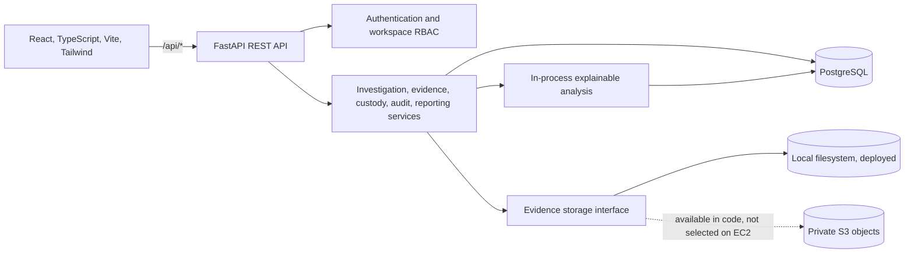
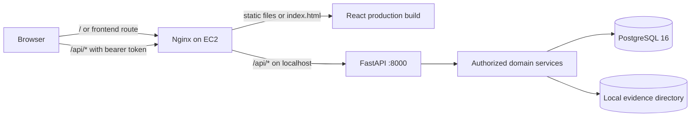
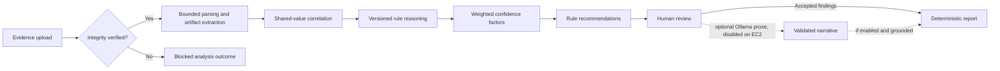
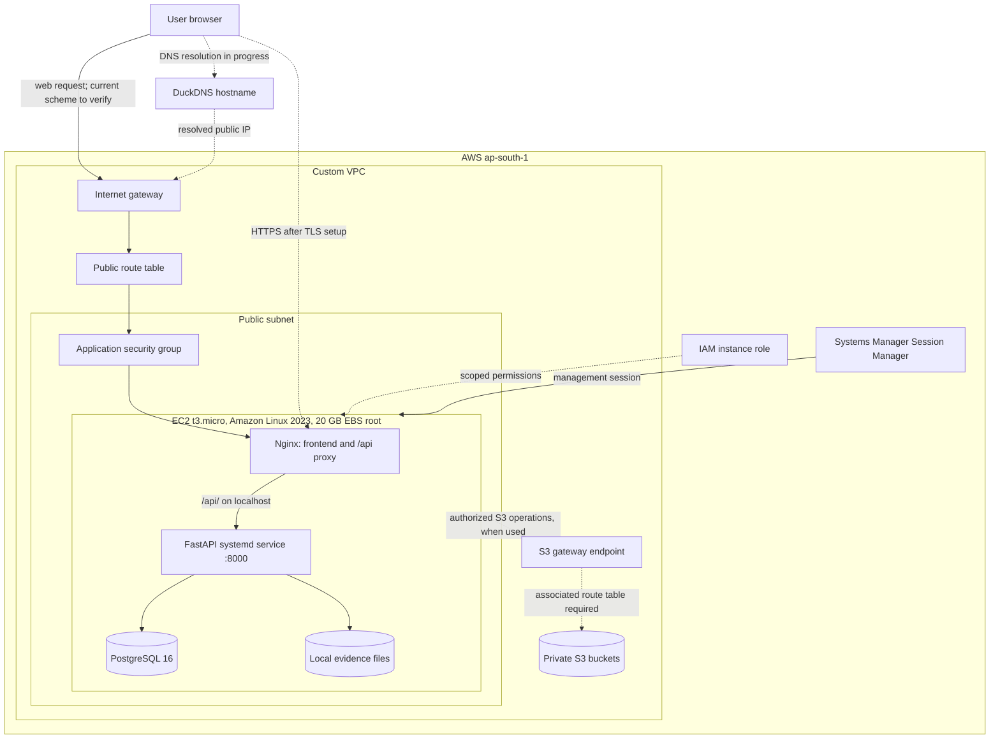

# Provena

Provena is an explainable AI-assisted digital forensic investigation platform designed to streamline evidence management, investigative analysis, and case reporting. It provides a centralized workspace where investigators can organize cases, preserve evidence integrity, maintain chain-of-custody records, examine correlated findings, and generate traceable investigation reports.

Built with React, FastAPI, and PostgreSQL, Provena combines structured investigative workflows with transparent, rule-based analysis and optional language-model-assisted reporting. Its AWS-hosted architecture supports centralized access, controlled deployment, and secure application operations.

## Key capabilities

- Manage workspaces, case teams, priorities, statuses, investigator notes, and scoped search.
- Register evidence under opaque storage keys with immutable SHA-256 baselines.
- Record verification outcomes and append-only chain-of-custody events.
- Process only verified evidence, with explicit outcomes for blocked or unsupported items.
- Extract provenance-bearing artifacts and correlate shared values across evidence.
- Propose findings through versioned rules with visible confidence factors and recommendations.
- Require human acceptance or rejection before findings enter immutable, content-hashed reports.
- Review investigation timelines and an append-only application audit trail.

The interface supports administrator, investigator, forensic analyst, and evidence custodian roles. The backend enforces workspace membership and investigation permissions for every protected operation.

## Architecture overview

Provena is a modular monolith. A React single-page application calls the FastAPI REST API; domain services own authorization, case operations, evidence handling, analysis, and reporting. PostgreSQL stores investigation records and analysis results. Raw evidence bytes are held by a separate storage backend, currently the local filesystem in the AWS deployment.



Alembic manages database schema changes. Evidence metadata, digests, verification history, custody events, artifacts, correlations, findings, reports, and audit records live in PostgreSQL. Raw evidence is stored separately. Backend checks remain the authorization boundary; hiding actions in the interface is only a usability aid. See [system architecture](docs/architecture.md), [evidence integrity](docs/evidence-integrity.md), and [security](docs/security.md).

### Request flow



Nginx serves the built frontend and forwards `/api/` requests without stripping their prefix. FastAPI authenticates and authorizes API calls before accessing records or stored evidence. [AWS deployment](docs/aws-deployment.md) explains the host and reverse-proxy setup.

## Investigation workflow and explainable AI

1. Create or join a workspace, then open a numbered investigation and assign its lead and team.
2. Register evidence. Provena streams the upload, computes an immutable SHA-256 baseline, and records its initial custody event.
3. Verify stored bytes against that baseline. Each attempt records the expected and observed digest and a `verified`, `mismatch`, or `unavailable` result. New evidence begins as `not_verified`.
4. Select evidence for analysis. Only `verified` evidence enters parsing; other integrity states receive explicit blocked outcomes.
5. Inspect extracted artifacts and shared-value correlations with their source evidence, locators, context, and extractor version.
6. Review rule-generated findings, matched conditions, weighted confidence factors, and recommended next steps. An investigator accepts or rejects each proposal.
7. Generate an immutable report from accepted findings, evidence and custody summaries, notes, and traceability data. The report includes a SHA-256 content hash. Audit events record meaningful actions throughout the workflow.



The implemented pipeline uses regular expressions, key-aware structured rules, conservative normalization, and `pypdf` for machine-readable PDFs. It supports text, log, CSV, JSON, and machine-readable PDF evidence, extracts 14 controlled artifact types, and applies three versioned rules: `identity-recurrence`, `removable-media-session`, and `external-transfer-sequence`. Confidence is a deterministic weighted ranking score from 0 to 100, **not a calibrated probability or Bayesian estimate**.

Optional Ollama integration can turn accepted, structured findings into report prose. Provena checks its JSON structure, referenced finding IDs, and concrete facts against the supplied context; invalid or unavailable model output falls back to deterministic prose. The model does not determine integrity, extract artifacts, run rules, score findings, or approve them. The AWS deployment has `LLM_ENABLED=false`. spaCy is not installed or used by the current pipeline. See [AI architecture](docs/ai-architecture.md) and [future enhancements](docs/future-enhancements.md).

## Cloud infrastructure

Provena runs in **AWS Asia Pacific (Mumbai), `ap-south-1`** on one Amazon Linux 2023 `t3.micro` EC2 instance with a 20 GB EBS root volume. The instance sits in a public subnet of a custom VPC behind security groups and an internet gateway. Nginx serves the React build and proxies API requests to a systemd-managed FastAPI process bound to localhost port 8000. PostgreSQL 16 and the active evidence directory reside on the same EC2 instance. Operators use AWS Systems Manager Session Manager; an IAM instance role scopes AWS access.

The AWS environment also has an S3 gateway VPC endpoint and separate S3 buckets for evidence-related resources, frontend-related resources, and operational backups or migration artifacts. The active application uses `EVIDENCE_STORAGE_BACKEND=local` with `EVIDENCE_STORAGE_ROOT`; bucket presence does not mean evidence is stored in S3 or frontend assets are served from S3. The gateway endpoint carries EC2-to-S3 traffic only if associated with the instance subnet's route table.



DuckDNS, Let's Encrypt certificates, Nginx HTTPS termination, HTTP-to-HTTPS redirection, renewal, and public-IP DNS updates are **configuration in progress**. Production URL: `https://<verified-duckdns-hostname>/` (placeholder until DNS and HTTPS acceptance). The current topology does not use CloudFront, RDS, a load balancer, Auto Scaling, or multi-AZ failover. One small EC2 instance is a shared failure domain for the API, database, and local evidence; coordinated backups and restore tests are important. See [AWS deployment](docs/aws-deployment.md) and [security](docs/security.md).

## Technology stack

| Layer | Technology |
| --- | --- |
| Frontend | React 19, TypeScript, Vite, Tailwind CSS v4, React Router, Vitest |
| API and services | Python, FastAPI, Pydantic v2, SQLAlchemy 2, Alembic, Uvicorn |
| Data | PostgreSQL 16; local evidence storage in the AWS deployment; optional private S3 backend in code |
| Analysis | Python parsers and rules, `pypdf`, deterministic correlation and confidence; optional Ollama HTTP narrative provider |
| AWS operations | EC2, EBS, VPC, security groups, internet gateway, S3 gateway endpoint, IAM instance role, S3 buckets, Systems Manager, Nginx, systemd |
| Security controls | bcrypt password hashes, JWT bearer tokens, workspace and case RBAC, SHA-256 integrity baselines, append-only custody and audit records |

The frontend stores its bearer token in `localStorage`, which page JavaScript can access. This is a security trade-off for a deployed web application; see [security](docs/security.md). Provena is not certified forensic software and makes no legal admissibility claim.

## Getting started

Local prerequisites: Python 3.13+, Node 22+, Docker with Docker Compose, and PowerShell.

```powershell
./scripts/dev.ps1 setup    # local PostgreSQL, dependencies, migrations, development accounts
./scripts/dev.ps1 demo     # optional synthetic five-case demo, idempotent
./scripts/dev.ps1 api      # FastAPI on localhost:8000, separate terminal
./scripts/dev.ps1 web      # Vite on localhost:5173, separate terminal
```

The Vite development proxy forwards `/api` to FastAPI. Development uses local evidence storage by default. Do not run the synthetic seed against production. The [development guide](docs/development.md) covers manual setup, configuration, migrations, tests, and optional local Ollama setup.

```powershell
# In backend/
python -m pytest

# In frontend/
npm run lint
npm run typecheck
npm test
npm run build
```

## Documentation and roadmap

- [System architecture](docs/architecture.md): modules, authorization, data flow, and service boundaries.
- [AI architecture](docs/ai-architecture.md): extraction, provenance, rules, confidence, review, and Ollama safeguards.
- [Evidence integrity](docs/evidence-integrity.md): registration, SHA-256 verification, custody, and analysis eligibility.
- [AWS deployment](docs/aws-deployment.md): Mumbai infrastructure, Nginx/systemd deployment, verification, and limitations.
- [Security](docs/security.md): authentication, IAM, network controls, storage, TLS status, and risks.
- [Local development](docs/development.md): setup, configuration, migrations, demo, and testing.
- [Future enhancements](docs/future-enhancements.md): proposed analysis and availability improvements.

Potential future work includes verified DuckDNS/TLS completion, stronger backup and monitoring practices, S3 evidence migration, managed PostgreSQL, higher availability, and carefully evaluated analysis additions. Bayesian scoring, knowledge graphs, cross-case inference, OCR, and spaCy-based NLP are not implemented.
