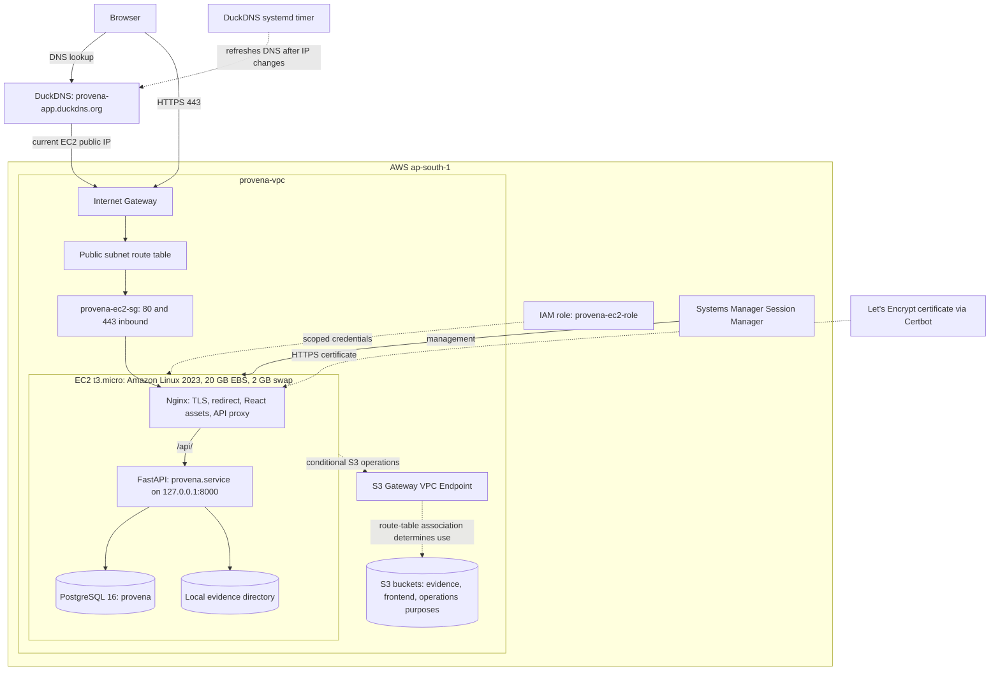
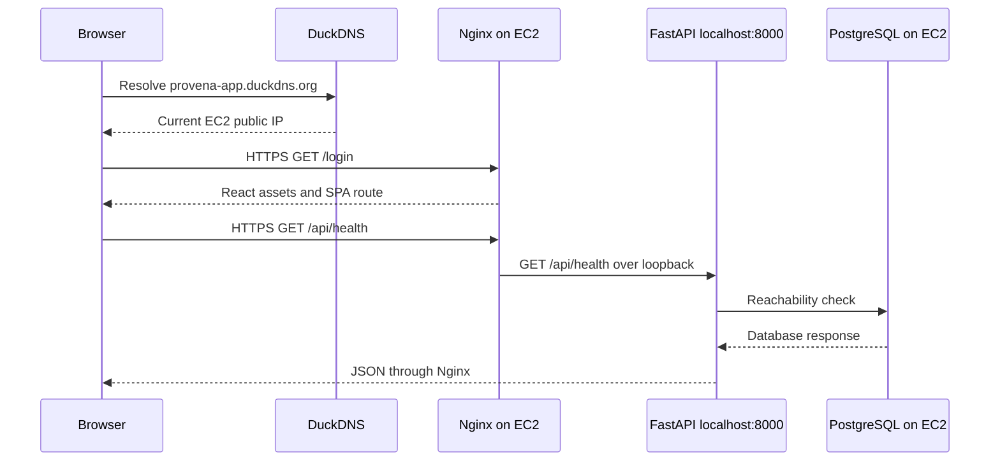

# Provena AWS architecture and deployment review guide

This guide is for team study and technical review. It separates three kinds of evidence: **repository-verified** means visible in application code or tracked documentation; **deployment-confirmed** means operational details supplied by the team for October 19, 2026; **reconstructed** means a safe sequence or command to reproduce or inspect the architecture, not a claim about exact historical shell commands. The repository has no infrastructure-as-code or copy of the live Nginx and systemd configuration. Do not paste secrets into commands or commit production configuration.

## 1. Introduction and deployment overview

Provena manages investigations, evidence integrity, custody, explainable analysis, human review, and immutable reports in one web application. AWS hosting provides a shared endpoint rather than a single developer's local machine, with a controlled network boundary and persistent host storage. The [live login](https://provena-app.duckdns.org/login) and [API health endpoint](https://provena-app.duckdns.org/api/health) are served over HTTPS (deployment-confirmed). Local development remains documented in [development.md](development.md).

The production build is a React/Vite SPA served by Nginx. Nginx forwards `/api/` to the FastAPI modular monolith on `127.0.0.1:8000`. PostgreSQL 16 and the active local evidence directory reside on the same EC2 host. The deterministic AI pipeline runs inside FastAPI. Production sets `LLM_ENABLED=false`; no Ollama service is required for extraction, correlation, rule findings, or deterministic reports (repository-verified configuration and deployment-confirmed setting).

## 2. AWS architecture overview



The Internet Gateway and public-subnet route provide internet reachability. The security group admits web traffic. Nginx handles TLS and static files, and proxies the API to loopback. FastAPI owns authorization, investigation services, evidence and report operations, and analysis. PostgreSQL stores structured records; the configured local evidence backend stores raw files under opaque keys. The S3 buckets and gateway endpoint are provisioned, but the live evidence API does **not** use S3 and the frontend is **not** served from S3. Endpoint use depends on route-table association and the operation's routing. The S3 evidence backend exists in code and would require an explicit storage migration before replacing local evidence.

## 3. AWS setup from scratch: reconstructed chronological walkthrough

These are **reconstructed procedures**, not verified historical commands. Begin with a locally working release, synthetic test data, AWS account controls, and an approved spending limit. Never run demo seeding or destructive database commands against the deployed data.

| Step | Configuration and why it matters |
| --- | --- |
| 1. Region | Select `ap-south-1` so EC2, network, EBS, S3 resources, and IAM policy references are consistent. Check account quotas and costs first. |
| 2. Network | Create `provena-vpc` and a public subnet. Attach an Internet Gateway; associate a route table with an internet route for the subnet. This makes the EC2 web listener reachable through its current public IPv4 address. |
| 3. Boundary | Create `provena-ec2-sg` with inbound TCP 80 and 443. Keep 8000 and 5432 off the public interface and do not open unrestricted administrative access. Review outbound access needed for package installation, DuckDNS, Let's Encrypt, SSM, and any S3 operations. |
| 4. Host and identity | Launch Amazon Linux 2023 `t3.micro` with 20 GB EBS and attach `provena-ec2-role`. Configure 2 GB swap to improve memory headroom, while monitoring for swap pressure. Enable Systems Manager Session Manager for administrative access. |
| 5. Runtime | Install the supported Python, Node, Nginx, PostgreSQL 16, and Certbot packages from trusted sources. The exact package commands and paths depend on the AMI and release. |
| 6. Database | Initialize PostgreSQL, create the `provena` database and a restricted application role, restrict database listening to local access, and record the data directory and backup plan. Use Alembic explicitly to migrate the release. The current repository has no live-host bootstrap script. |
| 7. Backend | Deploy a reviewed code revision and isolated Python environment. Place production variables and secrets in a protected file outside Git. Start one Uvicorn worker on `127.0.0.1:8000` using `provena.service`; verify `/api/health` and database-backed `/api/ready` locally. Do not run the development seed. |
| 8. Frontend | Install locked dependencies and build Vite with a same-origin `/api` path. Copy only the production `dist/` assets to an Nginx-readable directory. Configure SPA fallback for frontend routes. |
| 9. Reverse proxy | Configure Nginx to preserve the `/api/` path and Authorization header when proxying to FastAPI. Set upload limits and timeouts appropriate to configured evidence limits. Avoid caching authenticated API responses. Validate Nginx before reload. |
| 10. Data migration | Back up source data first; migrate database records with explicit schema versioning and copy evidence bytes with checksum validation. Preserve evidence storage keys, SHA-256 baselines, custody history, and report hashes. The repository does not establish which exact migration commands were used historically. |
| 11. S3 network/resources | Provision separate private S3 buckets for the stated purposes, scope instance-role permissions, and configure the S3 Gateway VPC Endpoint and its route-table association. Do not switch `EVIDENCE_STORAGE_BACKEND` from `local` merely because a bucket exists. Verify bucket policy, encryption, retention, and actual backup jobs on AWS. |
| 12. Domain | Point `provena-app.duckdns.org` to the current public IP. Keep the token root-protected at `/etc/duckdns/token`; `/usr/local/bin/update-duckdns.sh` is triggered by `duckdns-update.service` and `duckdns-update.timer` approximately every five minutes. This avoids treating a changing EC2 public IP as the canonical address. |
| 13. HTTPS | Use Certbot and Let's Encrypt to obtain a certificate for the DuckDNS name, integrate it with Nginx, redirect port 80 to 443, configure automatic renewal, and test with a dry run. Confirm browser access and API calls over HTTPS. |
| 14. Acceptance | Check DNS resolution, HTTPS frontend 200, HTTP 301 redirect, `/api/health` and `/api/ready`, login and RBAC, synthetic evidence workflows, report access, service health, backup and restore, and monitoring. Only the specific tests listed below are deployment-confirmed; the rest remain recommended checks. |

The deployment-confirmed checks are: HTTPS frontend returned HTTP 200; HTTP returned HTTP 301 to HTTPS; `/api/health` reported healthy FastAPI and PostgreSQL; DuckDNS resolved to the public IP; the updater completed successfully; and Certbot's renewal dry run succeeded. These facts do not prove that every authenticated workflow, restore, or long-term renewal has been retested in production.

## 4. AWS services and host software

| Component | Why Provena uses it and how it connects |
| --- | --- |
| Amazon EC2 | Runs Nginx, FastAPI, PostgreSQL, local evidence, and systemd on one small, manageable host. `t3.micro` limits cost but shares CPU and memory across all workloads. |
| Amazon VPC | `provena-vpc` provides the network boundary that contains the subnet, route table, gateway, security group, and endpoint. |
| Public subnet | Allows the instance to have a public IPv4 path for direct browser access without a load balancer. Public subnet placement does not itself expose every port. |
| Route table | Directs subnet traffic toward the Internet Gateway and, when associated, eligible S3 traffic to the gateway endpoint. It chooses a path; it does not authorize an API call. |
| Internet Gateway | Connects the VPC to the internet for the public endpoint and outbound access. |
| Security group | `provena-ec2-sg` filters instance network traffic. Confirmed inbound web ports are 80 and 443; FastAPI and PostgreSQL should remain unexposed publicly. |
| IAM role and policies | `provena-ec2-role` supplies temporary AWS credentials to the instance. Permissions should be limited to actual S3 and management operations; no AWS key belongs in the app environment. Exact policy statements are not in the repo. |
| Amazon EBS | The 20 GB root volume persists filesystem bytes across normal stop/start cycles, including the local database and evidence if their directories are on this volume. Encryption, snapshots, and retention require account-side confirmation. |
| Amazon S3 | Buckets exist for evidence, frontend, and operational purposes. Provisioning is not proof of active application use. The application-selected evidence backend is `local`; S3 evidence support is optional code. Verify any backup or artifact upload job separately. |
| S3 Gateway VPC Endpoint | Provides a VPC route to S3 for associated route tables. It does not change application storage selection or grant IAM permission. |
| Systems Manager Session Manager | Provides administrative sessions through AWS management facilities. The host needs a working agent, role permissions, and connectivity; exact session access policy is an account-side control. |

Nginx, FastAPI, PostgreSQL, systemd, Certbot, and the DuckDNS updater are software or external services used **on or by EC2**, not additional AWS-managed application services. DuckDNS is the DNS provider; Let's Encrypt is the certificate authority.

## 5. Networking and request flow

For `https://provena-app.duckdns.org/login`, the browser resolves the DuckDNS name to the current EC2 public IP. Packets reach the public subnet through the Internet Gateway and its route. The security group permits 443. Nginx presents the Let's Encrypt certificate, terminates TLS, and serves the SPA's `index.html` and assets. React renders the login route. Port 80 requests instead receive a 301 redirect to HTTPS. DNS updates follow public-IP changes, subject to the updater timer and DNS propagation.

For `/api/health`, React or a monitoring client sends a same-origin HTTPS request. Nginx forwards `/api/health` to FastAPI on loopback without stripping `/api`. The backend health handler checks database reachability and returns a status body. **Important:** `/api/health` returns HTTP 200 even if the database is unreachable and reports the database state in JSON. `/api/ready` is the stronger database readiness probe and returns HTTP 503 when PostgreSQL is unavailable (repository-verified). The team-confirmed health response included a healthy database; do not equate a bare HTTP 200 with database readiness.



## 6. Security architecture

TLS protects browser-to-Nginx transport. The certificate for the DuckDNS name was issued October 19, 2026 and expires January 17, 2027 unless renewed. Automatic renewal is configured and its dry run succeeded; operators still need expiry monitoring. Port 80 redirects to 443. The DuckDNS token resides in a root-protected file outside Git. FastAPI binds only to `127.0.0.1:8000`; PostgreSQL is hosted locally, not on RDS or Aurora. Instance-role credentials avoid hardcoded AWS access keys. Session Manager reduces the need for exposed SSH.

Application controls include bcrypt password hashing, JWT bearer tokens, workspace and investigation RBAC, SHA-256 baselines, verification records, and append-only custody and audit operations. Only verified evidence enters deterministic analysis. Browser bearer tokens are stored in `localStorage`, which is readable by page JavaScript if script injection occurs. HTTPS is a working transport control, **not** proof of comprehensive production hardening or forensic certification.

Before broader production use, replace or disable demo credentials, rotate and protect `SECRET_KEY` and database secrets, review `CORS_ORIGINS` and trusted-proxy settings, inspect Nginx security headers, restrict host and IAM access, patch dependencies, test backups and restores, monitor disk and memory, and confirm EBS/S3 encryption and retention. The repository does not prove completion of those account- or host-side controls. Never include passwords, tokens, or evidence contents in logs or study notes.

## 7. Data storage and persistence

EC2 is compute; its ephemeral public IP may change after stop/start. The 20 GB EBS root volume is persistent block storage attached to the instance. PostgreSQL stores users, workspaces, investigations, evidence metadata and hashes, verification/custody history, analysis artifacts, findings, reports, and audit records. The active local evidence backend stores raw files under opaque generated keys on the EC2 filesystem. Confirm the exact evidence root and PostgreSQL data directory on the host before any backup or disk operation. The 2 GB swap file supports memory pressure but is not a database or backup destination.

S3 is separate object storage. Provena has a private S3 evidence backend in code, but production selects local storage; no automatic migration occurs. Other S3 buckets may hold assets or operational artifacts only if a separate workflow actually writes them. A database backup alone cannot restore raw evidence; backup plans must cover both PostgreSQL and evidence bytes and validate digests on restore.

On a normal EC2 stop/start, the attached EBS volume persists, but the public IP can change and DuckDNS must refresh. A systemd service can restart when the OS boots if enabled; verify actual enablement. Termination is different: deletion behavior depends on the EBS **Delete on termination** setting, and neither snapshots nor backups are guaranteed by having an EBS volume. Treat termination and volume replacement as potential data-loss events until recovery is tested.

## 8. Deployment operations and maintenance

The commands below are read-only unless marked. Use Session Manager on the correct instance; do not run them against an unknown host. Service names for PostgreSQL and Certbot vary by installation, so discover them first.

```bash
sudo systemctl status provena.service nginx duckdns-update.timer
sudo journalctl -u provena.service -n 100 --no-pager
sudo journalctl -u duckdns-update.service -n 50 --no-pager
sudo nginx -t
systemctl list-units --type=service '*postgres*' '*certbot*'
systemctl list-timers --all | grep -E 'duckdns|certbot'
sudo certbot certificates
curl -I https://provena-app.duckdns.org/login
curl -I http://provena-app.duckdns.org/login
curl -fsS https://provena-app.duckdns.org/api/health
curl -fsS https://provena-app.duckdns.org/api/ready
df -h
free -h
```

For a controlled maintenance window, `sudo systemctl restart provena.service` restarts only the API; active requests are interrupted. `sudo systemctl reload nginx` applies a validated Nginx configuration; run `sudo nginx -t` first. `sudo systemctl stop provena.service` takes the API offline; `start` restores it. PostgreSQL stop/restart interrupts database-backed workflows and should follow a tested backup and maintenance plan. `sudo certbot renew --dry-run` exercises renewal without replacing the production certificate; it may contact Let's Encrypt test services. Do not display `/etc/duckdns/token` or environment files to diagnose failures.

If login loads but API fails, check `/api/ready`, `provena.service`, Nginx `/api/` proxying, browser network responses, and PostgreSQL connectivity. If DNS fails after a stop/start, compare the current public IP with DNS and inspect the DuckDNS timer logs. If HTTPS fails, inspect certificate validity and Nginx status, then Certbot timer and renewal logs. If evidence is unavailable, inspect storage-root permissions and backup state; never change immutable SHA-256 baselines to make verification pass. High swap activity or a full 20 GB volume warrants capacity action, not repeated blind restarts.

## 9. Cost and infrastructure trade-offs

One `t3.micro` and self-hosted PostgreSQL keep the number of billed services small and the topology understandable. DuckDNS avoids a paid domain or Route 53 hosted zone for this deployment; Let's Encrypt provides certificates without certificate purchase. RDS, Aurora, an Elastic IP, and a load balancer are not required for a single-instance web application with Nginx and changing-IP DNS updates. An Elastic IP might simplify addressing but can still incur charges; it is not part of this topology.

This is **not guaranteed free**. EC2 runtime, EBS capacity and snapshots, public IPv4, S3 storage and requests, and any other account usage may incur charges. AWS Free Tier or promotional-credit eligibility depends on the account, date, region, and current terms; check billing and credits in the AWS Console before changes. No fixed price is asserted here. A single instance is also a single failure domain, with limited CPU, memory, disk, and maintenance flexibility. If usage grows, first measure resource pressure and test backups, then consider separating PostgreSQL or evidence storage, improving monitoring, and adding higher availability only when justified and funded.

## 10. AWS review preparation: questions and answers

1. **Why EC2?** It hosts the existing FastAPI, Nginx, PostgreSQL, and local evidence stack with minimal architectural change.
2. **Why a custom VPC?** It groups the application's network resources and makes routing and security boundaries explicit.
3. **Why a public subnet?** The single instance serves the public web endpoint directly, without a load balancer.
4. **What does the Internet Gateway do?** It provides a path between the VPC and the internet when the route table and security rules allow it.
5. **Route table versus security group?** A route table chooses where packets go; a security group filters traffic allowed to or from the instance.
6. **Which inbound ports are confirmed?** HTTP 80 and HTTPS 443. FastAPI 8000 and PostgreSQL 5432 should not be public.
7. **Why use an IAM instance role?** It provides temporary AWS credentials to the host without hardcoded access keys.
8. **What does Session Manager provide?** Administrative access through AWS management facilities when its agent, role, and connectivity are working.
9. **Why Nginx?** It serves static React files, terminates TLS, redirects HTTP, and proxies `/api/` to FastAPI.
10. **Why FastAPI on loopback?** Only Nginx needs to reach it; direct public access to port 8000 is unnecessary.
11. **Where is PostgreSQL?** PostgreSQL 16 and the `provena` database run on EC2, not RDS or Aurora.
12. **What does EBS store?** The 20 GB root volume persists host filesystem data across normal stop/start, subject to lifecycle and backup settings.
13. **Where are raw evidence files?** In the configured local evidence directory on EC2, not the provisioned S3 evidence bucket.
14. **What are the S3 buckets for?** They are provisioned for evidence-related, frontend-related, and operational purposes. Actual use must be verified per workflow.
15. **Why an S3 Gateway Endpoint?** It can route eligible instance-to-S3 traffic through the VPC route table; it does not select S3 as the app's storage backend.
16. **What if the public IP changes?** DuckDNS updates the hostname to the current address, with a timer running about every five minutes.
17. **How is the DuckDNS token protected?** It is stored in a root-protected file outside Git at `/etc/duckdns/token`.
18. **How does HTTPS work?** Nginx presents a Let's Encrypt certificate for the DuckDNS name and redirects HTTP to HTTPS.
19. **What if the certificate expires?** Browser trust fails; automatic renewal is configured, but operators must monitor it. A dry run has succeeded.
20. **Does `/api/health` prove database readiness?** Not by status code alone. Read its `db` field or use `/api/ready`, which returns 503 if the database is down.
21. **Is AI analysis dependent on Ollama?** No. Extraction, correlation, rules, confidence, and fallback reports are deterministic; `LLM_ENABLED=false` on EC2.
22. **What are the biggest risks?** One EC2 failure domain, local database and evidence, limited resources, and backup or secret-management controls that need account-side verification.
23. **How would we improve availability?** Test backup and restore first, then consider separate managed data services, replicated storage, monitoring, and redundant application hosts as cost and requirements permit.
24. **Is the deployment fully production-hardened?** HTTPS works, but that does not certify security, backup recovery, availability, or forensic admissibility.

## 11. Final architecture summary

Provena is operational at [https://provena-app.duckdns.org/login](https://provena-app.duckdns.org/login), with a working HTTPS frontend, HTTP redirect, DuckDNS updates, and configured certificate renewal (deployment-confirmed). In `ap-south-1`, a public-subnet `t3.micro` runs Nginx, systemd-managed FastAPI, PostgreSQL 16, and local evidence storage on a 20 GB EBS-backed host. VPC routing, the Internet Gateway, security group, IAM role, Session Manager, S3 buckets, and an S3 gateway endpoint support its network and operations. The code also implements optional private S3 evidence storage and optional grounded Ollama narrative rendering, but neither is selected for the current EC2 workflow. The architecture is simple and affordable to operate relative to a multi-service design, while requiring disciplined backups, monitoring, patching, and capacity review.
