# AI and analysis architecture

The implemented pipeline is deterministic parsing, extraction, shared-value
correlation and three explainable rules. It uses FastAPI's modular monolith and
PostgreSQL for persistence. It performs no machine learning, Bayesian inference,
OCR, authentication-event normalization or autonomous incident reconstruction.
Scores rank rule support; they are not calibrated probabilities.

```mermaid
flowchart LR
    E[Ready independently verified evidence] --> S[Fresh hashed private snapshot]
    S --> P[Bounded parsing and explicit coverage]
    P --> A[Versioned artifacts and source spans]
    A --> C[Immutable semantic correlation snapshots]
    C --> F[Versioned rule proposals and factors]
    F --> H[Human accept or reject]
    H --> V[Recheck integrity and current support]
    V --> R[Deterministic authoritative report]
```

## Authoritative narrative safety

M2 removes free-form model output from authoritative reports. ID and literal
validation cannot reliably reject invented causation, allegations, certainty or
negation reversal. Stronger prompts do not solve that semantic trust problem.
Narratives assemble fixed templates and the exact accepted deterministic finding
titles/summaries, with explicit scores and source references. They do not
paraphrase or reinterpret conclusions. User descriptions, titles and investigator
notes remain labeled report metadata, never narration instructions.

Legacy Ollama settings and the optional availability probe remain compatible,
but even an explicitly enabled provider cannot contribute report prose. No model
generation request is made, so prompt injection, malformed responses, timeouts
and unavailable models cannot control report conclusions. The metadata records
`provider=deterministic`, template version and context hash. The existing
`deterministic_fallback` mode is retained for API compatibility. Existing model
reports remain unchanged historical snapshots, with a visible M2 warning.

This deliberately narrows the old optional narration feature. Reintroducing
free-form authoritative paraphrases requires a separately justified design;
a literal blacklist is insufficient. No new model dependencies were added.

## M1 input provenance and historical support

Analysis now hashes a bounded private temporary copy and parses that same copy.
Recorded verification status is necessary but not sufficient. Each processed run
outcome records its exact digest and verification ID, and artifacts retain the
input digest. Legacy artifacts remain visible but do not enter new reasoning
until reanalysis binds them to a freshly checked input. New findings/reports
recheck supporting storage; degraded or unbound accepted findings are excluded
from new reports with explicit IDs, without rewriting historical reports.
Correlation row identities remain stable across identical rebuilds. See
[evidence integrity and recovery](evidence-integrity.md) for lifecycle, limits,
recovery procedures and the distinction between historical results and current
recorded eligibility. No new extraction rules or event schema are introduced.

## M2 parser coverage and coordinates

Pipeline 2 scans decoded source text separately from the 280-character display
excerpt. Extractor 2 plus parser 2 version the changed artifact semantics; earlier
artifacts retain their original version. Repeated occurrences retain distinct
spans. Spans are zero-based, half-open Unicode codepoint positions within a
source line, decoded CSV cell, decoded JSON scalar or PDF extracted line. They
are never advertised as original byte offsets. CSV column ordinals and JSON
Pointers supplement human-readable locations. Structured decoding and PDF text
extraction cannot provide exact original file character offsets.

Each new run/evidence outcome preserves parser coverage. Complete, partial and
rejected inputs are distinct. Limits are 10 MiB text/CSV/JSON, 25 MiB PDF,
10,000 characters per value/line, 50,000 source units, 2,000,000 scanned characters,
10,000 persisted artifacts per evidence, JSON depth 20 and 50 PDF pages.
Exceeding a byte limit rejects the parse. Record, character and PDF page budgets
produce explicit partial outcomes, not complete coverage. PDF coverage records
total pages, processed pages, skipped-page reasons and unprocessed page count.
Invalid UTF-8 replacements are explicit. Image content is not OCR-processed.
PDF decoding still uses an in-process library, not a hostile-document sandbox.
Historical outcomes without coverage remain unknown, not retroactively complete.

## M2 stable support and review history

Each run records its exact artifact memberships. Current reasoning uses only
artifacts emitted by the latest completed attempt for each item, under the
current parser/extractor version and M1 integrity gate. Historical artifacts,
findings and reports remain addressable. Failed or rejected newer attempts do
not silently substitute older extraction results.

Correlations are immutable support snapshots: a semantic SHA-256 identifies the
algorithm version, entity type/value and sorted supporting artifact identities.
An artifact identity includes its evidence ID, input digest, source occurrence,
extractor name and parser/extractor version. Database sequence allocation is not
part of the semantic hash. Changed support creates a new correlation snapshot;
old memberships are never deleted or rewritten. A current flag selects the
latest view without destroying historical references.

Finding keys cover rule/version, semantic supporting artifacts, explicit claim,
score/factors and parser coverage. Identical proposals reuse accepted/rejected
rows. Changed support or versions require a new pending decision. Legacy rows
are retained, never retroactively assigned new provenance or approval. Reports
snapshot support and coverage alongside the original finding. PostgreSQL
investigation row locks serialize analysis, correlation rebuilds, proposals and
report numbering. These are transaction controls, not a distributed job queue.

## M2 rule support, scores and output accounting

Rule version 2 associates removable-media identifiers only within a structural
record (text line, CSV row or JSON parent object). Unique fields are described
as co-recorded entities, never an established session. Missing or multiple fields
remain explicitly ambiguous observations. Whole-file co-occurrence cannot join
unrelated users, hosts and devices.

All scores equal the sum of their declared factors. Verification concerns only
cited supporting inputs. Identity recurrence counts distinct normalized record
patterns for additional weight, not copies or partitions of the same logs.
These patterns do not establish independent acquisition sources. Upload sequence
scores no longer have an unexplained base contribution; link artifacts are
included in support. An upload cue and explicit file-access cue are required;
destination ownership and actual movement still require independent validation.

Rules enumerate deterministically and emit 25 proposals per rule by default.
Generation accepts `per_rule_limit=1..200`, also exposed by the UI expansion
action. Counts of enumerated, emitted and omitted proposals and the configured
limit persist in the generation audit event; `GET .../analysis/findings/coverage`
retrieves the latest accounting, and reports snapshot it. Upload pairing has a
100,000-candidate comparison budget. If exhausted, evaluation is explicitly
incomplete and total possible results are unknown. Raising the output limit does
not override processing budgets. Source coverage warnings accompany findings;
no result claims to describe unexamined content.
