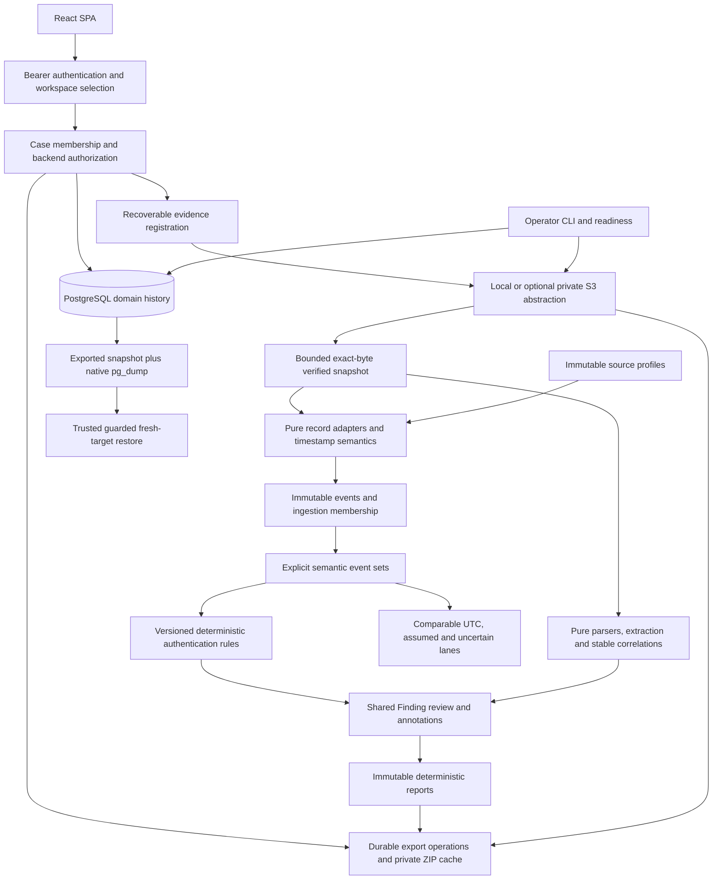

# Current architecture

Provena is a single FastAPI modular monolith, React/TypeScript SPA and PostgreSQL 16
system. No queue, microservice, search cluster or model is required. This describes
repository behavior, not an attestation of the live AWS host.

## Code boundaries

- `frontend/src/`: functional React pages, shared UI primitives, auth/theme/toast state,
  typed API client. `frontend/e2e/` is separate real-browser testing.
- `backend/app/modules/`: auth, workspaces, users, investigations, evidence, events,
  detections, intelligence, audit, dashboard and exports. Routers validate requests;
  services own permissions and transaction boundaries; SQLAlchemy models persist state.
- `backend/app/ai/`: pure bounded artifact parsers, normalization, correlation and rules.
- `backend/app/events/`: pure record-aware Linux/Windows/Sysmon adapters, source-time
  interpretation and authentication pattern engine. No database or FastAPI dependency.
- `backend/app/ops/`: standalone archive verification, guarded native backup/restore,
  read-only preflight and explicit cache maintenance. Archive verification is standard
  library only. `tools/` contains maintainer release, documentation and browser runners.
- `backend/alembic/`: forward-only schema history. Production startup does not silently
  apply migrations. The local development Compose command explicitly migrates its own DB.

## Authorization

A global account can belong to multiple workspaces. Active workspace membership is the
first boundary; case membership or workspace administration is the second. Workspace
administrators cannot globally disable an account. Suspension applies immediately on
protected backend requests and does not disable unrelated workspaces.

Case management belongs to the workspace administrator, creator or lead. Assigned
forensic analysts can initiate analysis/ingestion and inspect findings but cannot accept
findings, generate reports or bundle originals. Evidence custodians and case managers
can verify evidence. Case readers can export metadata. Archived cases restrict ordinary
mutations; historical read access remains available. UI controls are guidance only.
See [security](security.md) for the trust boundaries and limitations.

## Persistence and reproducibility

PostgreSQL stores application history, baseline digests, profiles, event/run memberships,
semantic event-set keys, reviewed findings, immutable report JSON and export operations.
Original bytes live behind `app/modules/evidence/storage.py`, under generated keys;
private archive caches use a separate root. Storage keys never appear in ordinary API
responses or case export metadata.

Fresh analysis, ingestion, detection support checks and originals exports consume exact
verified private copies. Historical verification flags alone are insufficient. Missing,
changed or incomplete evidence produces explicit blocked/failure states. Registration,
ingestion, detections and exports have recoverable operation records; retries do not
silently delete history. PostgreSQL case locks serialize relevant publication/recovery.

Logical analytical identities include input/version/profile semantics, not sequence
allocation. Explicit event sets prevent duplicate ingestion or alternative interpretations
from becoming independent activity. Accepted/rejected reviews survive equivalent reruns;
changed support requires fresh review. Reports preserve their original content hashes.

## Time, findings and reporting

Original timestamps and uncertainty are preserved. UTC comparisons require justified
projections; profile assumptions are explicit and opt-in for detections. Unknown year,
unknown timezone and ambiguous DST times do not establish success-after-failure claims.
Timeline lanes separate uncertainty; equal times and IP matches do not prove causation.

Five threshold-based families describe observable authentication patterns. Severity is
review priority, not a probability of compromise. Legacy artifact scores remain declared
weighted heuristics. Human acceptance is mandatory for report conclusions. Authentication
reports require explicit event-set selection. Free-form LLM prose is excluded.

## Operations and release

Case exports use bounded disk-backed ZIPs with versioned unsigned manifests, explicit
selection and per-file hashes. The verifier checks structure, provenance, limits and
report/original references without extracting or executing content. System backup is a
separate private whole-database operation using PostgreSQL exported snapshots, immutable
baseline-verified originals and native tools. Restore requires trusted package hashes,
fresh empty targets and complete fingerprint/hash validation before readiness.

`/api/live` checks process response; `/api/ready` checks required dependencies/schema/
storage without exposing internal paths. CLI diagnostics are read-only and explicit.
Logs use bounded correlation IDs and omit bodies/tokens. Local Compose is loopback-only.
CI tests disposable systems and produces validation-only candidates, never deployments.
See [operations](operations.md), [release policy](releases.md) and
[implementation evidence](m6-implementation.md).
