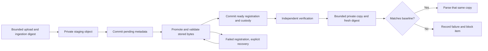

# Evidence integrity, provenance and recovery

Provena records ingestion bytes and subsequent handling. It is not certified
forensic software. SHA-256 and append-only APIs do not prove lawful acquisition,
source truth, operator honesty or legal admissibility.

## Registration lifecycle

Evidence has separate registration (`pending`, `failed`, `ready`) and integrity
(`not_verified`, `verified`, `mismatch`, `unavailable`) states. Only ready,
previously verified evidence enters analysis preparation. Ready does not mean
verified. Existing records migrate to ready; their historical analysis provenance
is not fabricated or backfilled.

Uploads are streamed with an explicit byte limit (default 100 MiB), hashed and
staged under generated keys. Empty/oversized uploads fail. Local writes flush and
fsync the staging file before promotion. PostgreSQL metadata commits as pending
before promotion; successful storage validation commits ready and a registration
custody event. This is a recoverable state machine, not a distributed transaction.
Pending/failed items remain visible with recovery instructions and cannot verify
or analyze. Promoted storage is rehashed before ready status is committed.

The baseline digest, uploader and registration timestamp never change through
metadata or recovery endpoints. Source/acquisition metadata can be corrected with
an audit event. Acquisition timestamps normalize to UTC; legacy naive acquisition
values are interpreted as UTC, not an independently verified source timezone.
Database event timestamps use timezone-aware UTC instants on PostgreSQL.

### Retry semantics

Identical uploads and normalized metadata by the same actor within one case
reuse a registration. Default deduplication includes digest, size, filename,
content type, title, description, evidence type, source and acquisition time.
Clients can provide `Idempotency-Key` (up to 128 characters) to distinguish
intentional identical registrations. A reused explicit key with different input
returns 409. Keys are hashed with actor identity and are not returned.

PostgreSQL locks the investigation row during registration allocation, and the
unique registration key constraint is a final guard. Recovery locks the evidence
row. These locks are tested in the disposable PostgreSQL CI job. SQLite tests
alone do not demonstrate transaction serialization.

## Recovery procedure

1. Inspect the item's registration and integrity states in Evidence details.
2. An authorized case manager can call
   `POST /api/investigations/{id}/evidence/{eid}/recover` or use Recover registration.
3. Recovery first checks whether a prior promotion already succeeded, then tries
   retained staging if needed. It validates the stored digest before marking ready.
4. If staging is lost, retry the original upload with identical metadata/key. The
   supplied original bytes can finish the existing incomplete registration.
5. Independently verify the recovered ready item before analysis.

Promotion/timeouts leave a failed record and retained recoverable staging where
possible. A process interruption can leave pending metadata. A lost database
commit acknowledgement is ambiguous, so staging is retained rather than deleting
possibly committed evidence. Retry resolves a committed matching registration.
A failure before metadata commits can leave an orphan, identifiable by local
`.part` files or S3 `.staging/` keys. No automatic deletion guesses ownership.

Local staging references are derived from generated keys. S3 staging keys are
`.staging/<generated-key>`; multipart uploads are aborted on handled failures.
If process termination or failed cleanup leaves multipart uploads, use a reviewed
bucket lifecycle policy for incomplete multipart uploads. Never blindly expire
completed staging objects backing pending/failed registrations. Reconcile a
protected database/storage inventory first, preserve unknown objects, and keep
backups outside Git. Operational cleanup is not an API endpoint.

Storage/provider paths and raw exceptions never appear in ordinary API errors.
No storage backend switch migrates existing objects automatically. Operators must
coordinate PostgreSQL and object backups and verify restoration against baselines.

## Exact-byte analysis contract

`storage.snapshot` opens the selected local/S3 stream once and copies it in
bounded chunks into a private temporary file while hashing. It reads at most the
registered size plus one byte. A growing source produces an explicit mismatch;
an unreadable source produces unavailable. A shorter/different copy mismatches
its baseline. No digest is invented for an over-limit stream that was not fully
hashed. Disk use is bounded by registered size, and parser input remains bounded
by per-format limits (10 MiB text/JSON; 25 MiB PDF).

After digest equality, the parser reads that same temporary file, not a reopened
mutable path. Source replacement during or after copying cannot substitute new
bytes for the validated parser input. This guarantees which bytes were analyzed,
not that the original storage remains unchanged forever or that the source was
acquired correctly. Temporary copies close on success and exceptions.

Each analysis check appends verification/custody/audit records with purpose and
initiating actor. Each run/evidence outcome links its verification and, when
processed, exact input SHA-256. Artifacts retain that digest and their original
locator/extractor version. A failed item does not prevent valid selected items
from completing. Unexpected run rollback retains observed integrity check results
while discarding partial analytical results; errors are sanitized.

## Current versus historical support

Historical artifacts remain visible. Legacy artifacts without exact-input
provenance are labeled and excluded from new reasoning until reanalysis.
New reasoning filters out non-ready, non-verified or unbound input. Generation
rechecks stored supporting evidence. Findings expose `support_current`, reflecting
recorded current eligibility, not continuous monitoring of storage.

New reports recheck evidence and exclude accepted findings whose complete
support is unavailable or lacks exact-input provenance. Excluded IDs and the
policy are visible in report content/UI. Accepted conclusions snapshot source
artifact locators, digests and extractor versions. Previously generated reports
are never rewritten; older reports explicitly remain historical snapshots.
Correlation identities are retained across identical rebuilds rather than
reallocated. Historical rows no longer contributing to current results are kept
for reference and omitted from current lists.

## Custody and assurance limits

Registration, manual/automatic verification, mismatch, unavailability and recovery
append custody/audit history. Automatic checks name their purpose and retain the
initiating actor where available. They do not transfer possession. Holder changes
come from explicit recipient-bearing registration/transfer/receipt/return events;
ordinary handling does not silently change holder. Custody transitions lock the
evidence row and validate recipients. System custody actions cannot be submitted
as ordinary user events, and no history update/delete endpoints exist.

This protects ordinary application operations, not privileged database/storage
modification. A report content hash is not a signature. Use least privilege,
protected consistent backups, independent operational controls and restore drills.

## Verification and reproducibility

The previously untracked `test_storage.py` is synthetic and relevant to both
storage backends, so M1 incorporates it. Untracked production-configuration tests
remain separate ongoing work and are not included merely to match a test count.
`test_evidence_foundation.py` injects changes, missing storage, read races,
promotion errors, database commit failures, lost acknowledgements and retries.
S3 tests use an in-memory fake and make no AWS requests. Frontend tests cover
registration/verification/recovery messages. PostgreSQL CI applies the migration,
checks schema drift and tests parallel idempotent registration. Docker was
unavailable locally, so a standalone PostgreSQL 16.15 server was
initialized in a new temporary directory on loopback port 55477. Full migrations,
schema drift checking and the parallel registration test passed against that
fresh synthetic database. The temporary server was stopped afterward. Offline
SQL compilation and SQLite tests alone are not PostgreSQL execution tests.

## M2 analytical support compatibility

Run-to-artifact memberships and immutable correlation support snapshots now
preserve exactly which extraction results were used. Parser coverage and source
timezone uncertainty travel with findings and reports. New processing versions
require new review where support changes; historical reports and decisions are
not rewritten. See [analysis architecture](ai-architecture.md).

Windows local storage compares resolved paths consistently across ordinary and
extended (`\\?\`) namespaces. Only the comparison representation is normalized;
validated keys, resolved-path containment and the original path used for I/O
remain enforced. Parallel staging tests cover the previously intermittent false
containment failure. This is not permission to follow evidence links outside the
configured storage root.
