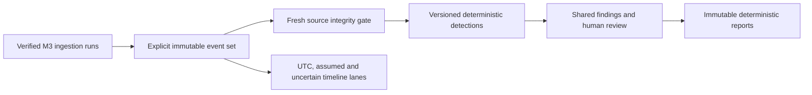

# M4 authentication investigation workbench

Historical milestone record. Later milestones extend this scope; use the current [guide index](README.md) for setup, operations and supported workflows. Original verification results below remain historical.

The implementation uses the existing modular monolith,
immutable normalized events and shared Finding review model. Production is not deployed.

## Selection and execution

Explicit case-scoped ingestion runs form immutable semantic event sets. Identical
reingestions reuse selections. Alternative source interpretations cannot be combined.
Copied/partitioned overlapping observations retain provenance but contribute at most
the maximum occurrence multiplicity in one source. Exact repeated observations are
counted once by detections. This conservative safeguard can undercount genuine identical
same-time records; it does not infer independent corroboration from copies.

Selected event membership is persisted, including excluded copy occurrences. The
10000-event selection limit rejects oversized inputs rather than truncating them.
Only completed or explicitly partial ingestion runs can be selected. Source coverage,
adapter and normalization semantics remain attached to the selection.

Detection execution freshly hashes selected evidence through M1 snapshots. It consumes
immutable M3 event interpretations, never a mutable source path. Failed integrity gates
block execution. Attempts are durable and results publish transactionally. Interrupted
attempts can be explicitly recovered while holding the case lock.

## Rules

Version 1.3 provides repeated failures, password spraying, success after failures,
explicit lockout concentration and mixed-outcome multi-account activity bursts.
Parameters are validated and persisted. Earliest qualifying non-overlapping rolling
windows make candidate selection deterministic. Qualitative severity describes review
priority, not compromise probability. There is no numerical score for these rules.
The shared legacy `confidence` column remains zero as a compatibility sentinel;
API/report `confidence_applicable=false` explicitly marks it as not a score.

Time-window eligibility requires a justified UTC projection and sufficient precision.
Profile-based assumptions require explicit opt-in. Unknown year/timezone and ambiguous
DST records never receive fabricated chronology. Success ordering requires more than
the failure's source precision interval plus configured clock uncertainty between
failures and success. Fractional projections are conservative to at least a microsecond.
Windows are half-open spans over reported UTC projections, not proven physical clock
intervals. Source precision and clock uncertainty can widen the underlying real-time
interval. Success ordering additionally requires non-overlapping precision intervals.
Source-clock synchronization is not independently validated.

Each rule exposes candidates, emitted results and omitted counts, with a configurable
1-200 result limit per family. Account scope preserves exact domain, username and host;
missing domain also retains provider namespace. IP equality does not identify an actor.

Findings retain exact support keys, event-set identity, engine/rule version and complete
configuration. Equivalent reruns preserve existing decisions. Changed support or input
semantics creates pending proposals. The existing review API is used, with before/after
decision snapshots appended to the audit log. Ordinary API append-only behavior does
not make database records cryptographically tamper-proof.

## Architecture

Migration `53d6b8a0e88b` adds selection, membership, detection run and run-finding
tables without altering old evidence, event, finding or report rows. It is forward-only.

## Investigator workflow

The case Authentication tab provides source-run selection, reusable immutable sets,
coverage and duplicate-source counts, configurable detection execution and run history.
Result details show rule versions, exact parameters, source event previews, temporal
limitations, shared acceptance/rejection controls, annotations and append-only review
history. Existing finding pages link back to this workbench and label detections as
threshold-based review priority rather than displaying a fabricated numerical score.

The timeline has source-declared UTC, profile-assumed and unknown/ambiguous lanes.
It supports offset-aware ranges, account/domain/host/IP/type/outcome filters, bounded
pagination and exact detection support filtering. Account pivots retain missing-domain
and provider scope. Source details link to evidence and original locators. A return
control preserves detection context during pivots. Ordering is not presented as causality.

New immutable reports include selection provenance, executed configurations, coverage,
omission accounting and a separate decision inventory. Accepted current detections retain
all support identities and up to 200 detailed event snapshots. Omitted detail counts are
explicit; the complete event membership remains queryable. Prior reports are untouched.

Authentication conclusions require `event_set_id` on report generation. The workbench
supplies it automatically. General reports without a selection exclude authentication
findings from conclusions and explicitly list the unselected findings. Historical
alternative interpretations remain visible in the separate execution inventory.

## Stable identity and storage

`investigation_event_sets` has a unique case/semantic-key constraint and stores name,
selection version, canonical first run references, coverage and actor/time. Semantic
hashing uses canonical JSON with SHA-256 over sorted selected event keys and deduplicated
source coverage, input digests, profile semantic keys and adapter/normalization versions.
Names, run sequence allocation and retry-specific `events_created` do not affect identity.
Equivalent retry run selections return the original immutable set and its first run references.

`investigation_event_set_members` preserves every selected event ID, observation key
and included/excluded-copy flag. `authentication_detection_runs` stores durable attempts,
selection reference, actor, engine version, complete configuration, verification links,
coverage, status and safe errors. `authentication_detection_run_findings` links completed
runs to the existing Finding rows. Foreign keys preserve support references. New indexes
cover case selection and case/set run queries; timeline uses M3 case/time/entity indexes
and indexed set membership. PostgreSQL case row locks serialize selection, detection and
recovery transactions. This is a synchronous bounded monolith operation, not a job queue.
Review decisions take the same case lock and refresh the preceding committed state.
Concurrent reviewers therefore produce an ordered audit transition chain rather than
two stale before-state snapshots; report generation sees a coherent decision snapshot.

Detection identity hashes selection semantic identity, engine/rule version, complete
validated parameters, deterministic proposal and exact contributing event keys. Sequence
IDs do not define logical identity. A different selected set, changed evidence/profile,
rule semantics or configuration creates a fresh pending proposal. This intentionally
does not carry approval to a different overall selection even when some support overlaps.
Earlier rule versions remain historical and cannot enter current conclusions automatically.

## Exact rule contracts and defaults

All families require justified UTC with second or finer precision. Profile assumptions
are excluded unless `allow_assumed_time=true`. Unknown year/zone, missing times and DST
folds/gaps are excluded explicitly. Equal or precision-overlapping times cannot establish
success-after-failure order. The default clock allowance is 1 second, an explicit bound
chosen by the analyst, not a measured synchronization guarantee.

| Rule | Default triggering criteria in 300 seconds | Scope and exclusions | Priority |
| --- | --- | --- | --- |
| `auth.repeated_failures` | At least max(5 failures, 5 distinct observations) | Exact account/domain/host, retaining provider for missing domain. Optional account/host/source or host/provider grouping. Missing IP is allowed in default grouping; missing account is allowed only for explicit host grouping. | Medium: repeated errors warrant validation, not a compromise assertion |
| `auth.password_spray` | At least 5 scoped accounts, at most 3 failures per account in qualifying window | Common source IP, exact host and domain/provider scope. Missing IP/account/host excluded. Shared NAT or services remain alternative explanations. | Medium: cross-account failure pattern |
| `auth.success_after_failures` | Success strictly after at least 5 earlier failures, beyond precision plus clock allowance | Exact account/domain/host/source IP. No cross-IP actor inference. Unknown chronology and equal timestamps excluded. | High review priority because of the supported transition, not certainty of compromise |
| `auth.lockout_concentration` | At least 3 explicit lockout events involving at least 2 scoped accounts | Exact host/domain/provider; Security provider Event 4740/account_lockout or supported Linux source-reported locked-account denial. Numeric IDs or ordinary failures alone do not establish lockout. | Medium: source-reported account-access impact |
| `auth.activity_burst` | At least 20 attempts across 3 scoped accounts, both successes and failures, failure fraction at least 0.5 | Exact host/domain/provider; ordinary success-only volume is excluded. No statistical or learned baseline. | Medium: declared mixed-activity threshold |

Every family uses earliest qualifying non-overlapping rolling windows in deterministic
time/key order. It reports observed windows rather than every possible overlapping
subwindow. Once a window qualifies, its members are consumed for that family/group.
Later near-overlapping subsets are not independent results. Supporting entity values,
time bounds, exact parameters, coverage and specific severity rationale are retained.
Patterns can have benign explanations; these rules cannot independently determine intent.

Primary counts use SSH/Windows logon outcome records and explicit non-SSH PAM failures
from login/su/sudo. SSH invalid-user and PAM companion messages remain explorable context,
with explicit `secondary_authentication_context` exclusion counts. They cannot inflate
a single exchange into several threshold-counted failures. Explicit lockouts participate
only in their dedicated family, not as extra logon outcomes. Counts are primary source
observations, not proven independent protocol sessions. SSH PAM-only exports therefore
remain context rather than triggering attempt-count detectors on incomplete semantics.

`GET .../authentication/rules` returns versioned definitions, required fields, defaults
and the complete Pydantic configuration schema. The UI exposes all parameters including
grouping, lockout/burst thresholds, clock allowance and per-rule result limits.

## API and processing budgets

All endpoints below are under `/api/investigations/{id}/authentication` and enforce
active workspace membership and case access. Writes additionally require the existing
finding-production permission. Review/report generation retains existing manager checks.

| Endpoint | Behavior |
| --- | --- |
| `GET /rules` | Versioned criteria and validated parameter schema |
| `GET /sets`, `POST /sets` | List up to 200 immutable selections; create from 1-50 explicit run IDs |
| `GET /runs`, `POST /runs` | Paginated execution history; execute selected set with validated parameters |
| `POST /runs/{id}/recover` | Close interrupted running attempt under case lock; never overwrite completed results |
| `GET /findings?event_set_id=...` | Deduplicated shared findings for the selected set, optionally filtered by run |
| `GET /findings/{id}/history` | Latest 100 case-scoped audit decisions with before/after review snapshots |
| `GET /timeline?event_set_id=...&lane=utc` | Filtered selected events; lanes `utc`, `assumed`, `uncertain` |

Timeline filters include exact username/domain/provider/host/source IP, outcome, type,
offset-aware start/end and finding support. Missing-domain pivots use `domain_missing=true`
plus provider/host namespace. UTC ranges are rejected for the uncertain lane. Uncertain
events are grouped by source and source line/row where available; other locators use
stable identity order. Neither source record order nor equal UTC time claims causality.
Pagination defaults to 50 events/findings, maximum 200. Runs default to 25, maximum 100.
Offsets are bounded at 100000.

Selections reject more than 10000 events instead of silently truncating. Detectors
evaluate at most that set, with 1-200 returned results per family (default 100), and
exact candidate/returned/omitted accounting. Coverage records evaluated and eligible
events, exclusions for duplicate observations/non-authentication/unsupported time,
per-rule required-field exclusions and evaluation completion. More results can be
retrieved by raising the explicit rule limit, up to 200, or selecting a narrower source
set. Above that documented bound, omitted results are not persisted as findings.

At most 200 detailed event snapshots are embedded per finding, with an omitted count;
all support keys and immutable event rows remain available through paginated timeline.
Report execution inventory is limited to the latest 25 runs plus the explicitly selected
set; older run count is recorded. Decision inventory is capped at 1000 and flags the cap.
Reports retain all existing accepted-finding support snapshots without rewriting history.

## Integrity, interruption and recovery

Evidence must remain ready, independently verified and digest-compatible. Detection
preparation opens only storage abstraction snapshots, freshly hashes original inputs,
then evaluates the immutable normalized events originally derived from those bytes.
It does not reopen a mutable source for parsing. Checks are point-in-time, not continuous
storage monitoring. Their IDs/digests/statuses are recorded in execution coverage.

A durable running attempt precedes the locked analytical transaction. New findings,
memberships and completion publish together. A failure rolls them back, journals source
verification outcomes into the failed attempt's custody/audit history, and returns a
safe error. Lost completion acknowledgement is resolved by rereading committed status.
After a process interruption, inspect run history and explicitly recover the stranded
running attempt before retrying. Recovery waits for an active executor's case lock.

## Demonstration and reproducible checks

See [synthetic M4 demonstration](../sample-data/m4-authentication/README.md). Its 51
recognized occurrences yield five default candidate findings. One duplicate observation,
six uncertain-time records and two contextual Sysmon records are explicitly excluded
from authentication temporal evaluation. Identical reingestion/reruns preserve all five
logical findings and accepted/rejected states.

The PostgreSQL suite uses only localhost database `provena_ci`. It tests concurrent
selection and detection, PostgreSQL JSON queries, a fresh migration chain and a populated
M3-to-M4 schema upgrade with preserved review decisions, event/run membership and report
hash. Each upgrade test creates a new disposable schema; it never downgrades old data.

## Verification results

Environment: Python 3.13.5, Node.js 22.17.0 and disposable local PostgreSQL 16.15 on
127.0.0.1:55480, database `provena_ci`. Clean dependencies were installed into
`$TEMP/provena-m4-clean-env`; no production configuration or evidence was used.

| Check | Command | Result |
| --- | --- | --- |
| Reviewed source backend suite | `python -m pytest -q` with `M1_POSTGRES_TEST_URL` set to the isolated PostgreSQL URL | 321 passed, including PostgreSQL integration tests |
| Rule boundaries | `python -m pytest tests/test_m4_engine.py -q` | 23 passed |
| Latest review/concurrency and workflow regression | `python -m pytest tests/test_postgres_evidence.py tests/test_m4_workbench.py -q` | 21 passed |
| Manual resource probes | `python -m pytest tests/benchmark_authentication.py -q -s` | 3 passed, CPU/SQLite/PostgreSQL measurements above |
| Python installation | `python -m pip install -r backend/requirements.txt pip-audit` in a new virtual environment | Resolved successfully |
| Python compatibility | `python -m pip check` | No broken requirements |
| Python vulnerability gate | `python -m pip_audit -r requirements.txt` from backend | No known vulnerabilities |
| Frontend installation | `npm ci` | Clean install succeeded |
| Frontend dependency gates | `npm audit` and `npm audit --omit=dev` | Zero vulnerabilities in both |
| Frontend quality | `npm run lint`, `npm run typecheck`, `npm run build` | Passed |
| Frontend behavior | `npm test` | 58 passed across 21 test files |
| Fresh schema and drift | `python -m alembic upgrade head`, `python -m alembic check` on isolated PostgreSQL | Passed, no new upgrade operations |
| Populated M3 upgrade and concurrent database behavior | `python -m pytest tests/test_postgres_evidence.py -q` with isolated PostgreSQL | 4 passed; includes selection/detection/review serialization and immutable history checks |
| Whitespace and staged-path inspection | `git diff --check`, `git diff --cached --check` | Passed; no environment, backup, evidence-storage or generated files staged |

Full-suite results are from an export of explicitly reviewed index entries, rather than
from a dirty working tree. The local checkout collects ten additional unrelated tests:
nine from the pre-existing untracked `test_config.py` and one modified health readiness
test. Those production-readiness changes remain uncommitted. This explains the local
331 versus reviewed 321 collected tests without silently bundling unrelated work.

The only observed test warning is the existing Starlette TestClient/httpx deprecation.
No security gate was disabled or advisory suppressed. Earlier M4 increments passed all
four GitHub Actions jobs. Final commit `2faf335c5dd9355d99e6deb3bab77414aebfdef2`
passed all four jobs in [CI #53](https://github.com/shikhar-sahay/provena/actions/runs/41997745754):
backend, frontend, dependencies and PostgreSQL migrations. Local and `origin/main`
matched that revision at closeout. M4 is complete; no production deployment was performed.

## Performance measurements

Single local Windows/Python 3.13 CPU probes are diagnostic measurements, not production
capacity estimates. A before/after engine-1.1 heap optimization comparison asserted
identical outputs: 1000 mixed events 0.0191/0.0179 seconds, 5000 events 0.1442/0.0947,
10000 events 0.4094/0.1931. A same-time stress case dropped from 9.5926 to 0.5059 seconds,
removing repeated rescans of immature failure records. Timing varies between runs.

The final engine-1.3 manual probe measured 0.0165, 0.0819 and 0.1535 seconds for mixed
1000/5000/10000 events, and 0.1278 seconds for 10000 equal-time records. The isolated
SQLite API probe for 2000 synthetic events measured selection 0.9667 seconds, first
detection 1.6152 seconds and rerun 1.2837 seconds, with 200 stable proposals.
These SQLite timings are explicitly not PostgreSQL or EC2 capacity measurements.

A local PostgreSQL 16.15 service probe with the same 2000-event workload measured
selection 1.1868 seconds, first detection 1.8155 seconds and rerun 1.3583 seconds,
with 200 stable proposals. An earlier trial measured 0.4598/1.7309/1.3107 seconds.
Concurrent local test processes and filesystem caching affect these single-trial results;
they do not establish EC2 capacity, sustained throughput or a latency guarantee.

Reproduce from `backend/` with
`python -m pytest tests/benchmark_authentication.py -q -s`.

## Limitations and M5 priorities

- No independent actor identity, session inference, malicious-intent determination or
  calibrated probability. No enforcement/remediation against external systems.
- Exact-value identity is conservative; account aliases, renamed hosts, Windows case
  semantics and cross-provider account resolution are not inferred.
- Duplicate observation safeguards can undercount genuine indistinguishable occurrences.
  Records with materially different source-declared fields are not automatically declared copies.
- No measured clock synchronization, timezone guessing, baseline anomaly model or native
  EVTX/OCR support. Unknown-time events remain explorable but cannot establish sequences.
- Detection execution is synchronous and capped at 10000 events. Larger source partitions
  need careful analyst selection; do not bypass budgets or silently combine interpretations.
- Review history is application append-only, not cryptographic tamper resistance. Existing
  old review events without decision snapshots remain historical without invented details.
- Storage regression tests cover local storage and a fake S3 object store. No real AWS,
  production database, live evidence or production deployment was accessed. Frontend
  behavior is covered by component tests; a manual browser/accessibility review remains useful.
- M5 should prioritize analyst validation against broader synthetic/known public examples,
  better source-clock documentation and explicit, audited suppression/tuning workflows.
  Improve compact support presentation and measure PostgreSQL workloads before raising budgets.
