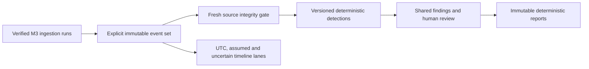

# M4 authentication investigation workbench

The implementation uses the existing modular monolith,
immutable normalized events and shared Finding review model. Production is not deployed.

## Selection and execution

Explicit case-scoped ingestion runs form immutable semantic event sets. Identical
reingestions reuse selections. Alternative source interpretations cannot be combined.
Copied/partitioned overlapping observations retain provenance but contribute at most
the maximum occurrence multiplicity in one source. Exact repeated observations are
counted once by detections. This conservative safeguard can undercount genuine identical
same-time records; it does not infer independent corroboration from copies.

Selected event membership is persisted, including excluded copy occurrences. The
10000-event selection limit rejects oversized inputs rather than truncating them.
Only completed or explicitly partial ingestion runs can be selected. Source coverage,
adapter and normalization semantics remain attached to the selection.

Detection execution freshly hashes selected evidence through M1 snapshots. It consumes
immutable M3 event interpretations, never a mutable source path. Failed integrity gates
block execution. Attempts are durable and results publish transactionally. Interrupted
attempts can be explicitly recovered while holding the case lock.

## Rules

Version 1.1 provides repeated failures, password spraying, success after failures,
explicit lockout concentration and mixed-outcome multi-account activity bursts.
Parameters are validated and persisted. Earliest qualifying non-overlapping rolling
windows make candidate selection deterministic. Qualitative severity describes review
priority, not compromise probability. There is no numerical score for these rules.

Time-window eligibility requires a justified UTC projection and sufficient precision.
Profile-based assumptions require explicit opt-in. Unknown year/timezone and ambiguous
DST records never receive fabricated chronology. Success ordering requires more than
one second plus the configured clock uncertainty between failures and success.
Source-clock synchronization is not independently validated.

Each rule exposes candidates, emitted results and omitted counts, with a configurable
1-200 result limit per family. Account scope preserves exact domain, username and host;
missing domain also retains provider namespace. IP equality does not identify an actor.

Findings retain exact support keys, event-set identity, engine/rule version and complete
configuration. Equivalent reruns preserve existing decisions. Changed support or input
semantics creates pending proposals. The existing review API is used, with before/after
decision snapshots appended to the audit log. Ordinary API append-only behavior does
not make database records cryptographically tamper-proof.

## Architecture

Migration `53d6b8a0e88b` adds selection, membership, detection run and run-finding
tables without altering old evidence, event, finding or report rows. It is forward-only.

## Investigator workflow

The case Authentication tab provides source-run selection, reusable immutable sets,
coverage and duplicate-source counts, configurable detection execution and run history.
Result details show rule versions, exact parameters, source event previews, temporal
limitations, shared acceptance/rejection controls, annotations and append-only review
history. Existing finding pages link back to this workbench and label detections as
threshold-based review priority rather than displaying a fabricated numerical score.

The timeline has source-declared UTC, profile-assumed and unknown/ambiguous lanes.
It supports offset-aware ranges, account/domain/host/IP/type/outcome filters, bounded
pagination and exact detection support filtering. Account pivots retain missing-domain
and provider scope. Source details link to evidence and original locators. A return
control preserves detection context during pivots. Ordering is not presented as causality.

New immutable reports include selection provenance, executed configurations, coverage,
omission accounting and a separate decision inventory. Accepted current detections retain
all support identities and up to 200 detailed event snapshots. Omitted detail counts are
explicit; the complete event membership remains queryable. Prior reports are untouched.
